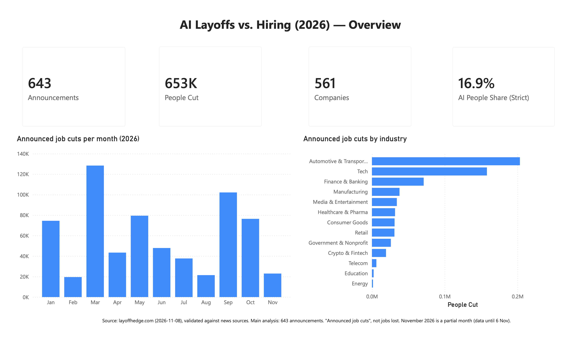
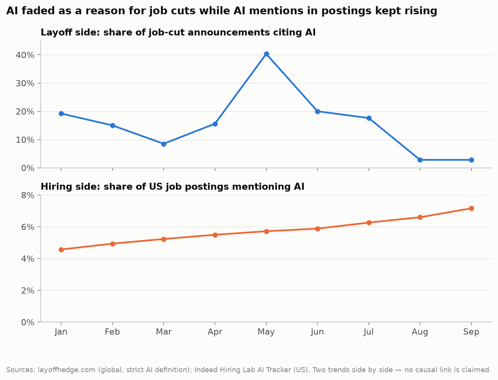
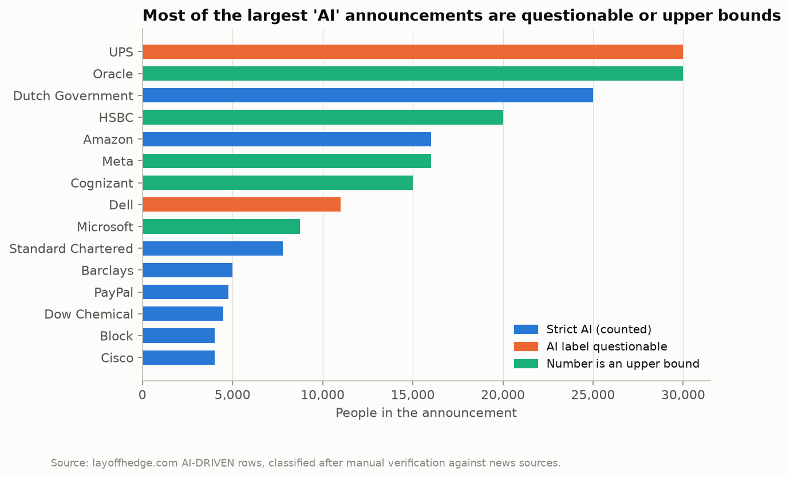

# Is AI taking jobs — or just taking the blame?

*AI in 2026 layoff announcements vs. AI in job postings*

**English** | [Türkçe](README.tr.md)

Every week there is a headline like *"Company X cuts thousands of jobs because of AI."* This project checks those headlines against data: **how often did companies actually name AI when they announced job cuts in 2026, how did that change over the year, and what happened to AI in job postings at the same time?**



---

## Key findings

| | Finding |
|---|---|
| **1 in 6** | About **1 in 6 people** in announced job cuts were in cuts that companies attributed to AI (**16.9%**, 95% CI 8.8–27.5%). With a looser definition that also counts vague "efficiency / automation" wording, it is at most 38.4%. |
| **40% → 3%** | AI as a stated reason **peaked in May** (40% of announcements) and **faded from August** (about 3–6% of announcements per month). An independent source, Challenger, Gray & Christmas, shows the same pattern for the US (correlation 0.72). |
| **295 vs 180** | AI-attributed announcements are **larger**: 295 people at the median vs. 180 for other announcements (difference 115, 95% CI 50–421; Mann-Whitney p < 0.001). |
| **2×** | On the hiring side, the share of **US job postings mentioning AI doubled** in one year (3.6% → 7.2%, Sep 2025 → Sep 2026); the UK followed the same path (4.9% → 9.8%). |

> **In one sentence:** in 2026, AI faded as a stated reason for job cuts while it appeared more and more in job postings.
> The two trends are shown **side by side — this is not a cause-and-effect claim.**



---

## The five questions

| # | Question | Answer |
|---|---|---|
| Q1 | Which industries announced the most job cuts? | **Automotive & Transportation (31%)**, **Tech (24%)** and **Finance & Banking (11%)** together make up two thirds of all people in announced cuts. Tech has the most announcements (139). |
| Q2 | In which industries is AI cited most often? | Among industries with enough announcements, **Crypto & Fintech** (68% of people) and **Finance & Banking** (33%) lead. Very small industries (fewer than 10 announcements) are flagged, because one announcement can swing them. |
| Q3 | How did the AI share change over the year? | High in January–July (8–20% of announcements, 40% in May), low from August (3–6%). Challenger's US figures move in the same direction. |
| Q4 | Are AI-attributed cuts bigger? | Yes: median 295 vs. 180 people, statistically significant. |
| Q5 | What happened in job postings? | The share of postings mentioning AI rose in every country tracked; the US and UK shares doubled. (Canada is shown but not compared: a new Ontario disclosure law makes employers mention AI use in hiring.) |

---

## Data

| Data | What it contains | Role | License |
|---|---|---|---|
| [layoffhedge.com](https://layoffhedge.com) 2026 layoff list (version of 8 Nov 2026) | 653 announcements worldwide: company, industry, people, date, reason, source link | Main data (layoff side) | Free to use with attribution |
| [Indeed Hiring Lab — AI Tracker](https://www.hiringlab.org/) | Daily share of job postings mentioning AI, 9 countries | Main data (hiring side) | CC BY 4.0 |
| [Challenger, Gray & Christmas](https://www.challengergray.com/) monthly reports | US job cuts and AI-attributed cuts, Jan–Oct 2026 | Independent cross-check | Public figures, quoted with attribution |

Details and attribution: [data/SOURCES.md](data/SOURCES.md). The raw files in `data/raw/` are never modified.

---

## How the data was checked

layoffhedge is not a well-known source, so the data was checked **before** it was analysed:

- **Automatic checks on all 653 rows:** blanks, duplicates, impossible values, missing years in dates, source-link quality.
- **146 rows checked by hand against news sources**: every announcement with 3,000+ people, every AI-labelled one, and a random sample of smaller ones. Together they cover **72% of all people** in the data.
- **What was found:** 4 announcements from the wrong year (Intel, Nestlé, Nokia, CrowdStrike: excluded) and 2 wrong numbers (Verizon 3,000 → 500, Commerzbank 6,900 → 3,000: corrected, original kept).
- **"Flag, don't delete":** no row was deleted. Every row has a reliability tier (T1 hand-verified … T5 weak source); **81.6% of people are in the top three tiers**.
- **Two AI definitions:** *strict* (the company clearly names AI; used for every headline number) and *broad* (also vague "automation / efficiency"; reported as an upper bound only).
- **Robustness and statistics:** the findings hold when weaker tiers are removed; bootstrap confidence intervals, a Mann-Whitney test, permutation tests and sensitivity analyses are in [docs/DATA_QUALITY.md](docs/DATA_QUALITY.md).



**Why announcements and not people for the trend?** One giant announcement can swing a month: in October, a single Dutch government plan (25,000 people) pushed the AI share of *people* to 50.5%, while only 5.3% of *announcements* cited AI. The announcement share is therefore used for the monthly trend.

---

## Limitations

- Only **announced** cuts that reached the news; small companies are under-represented.
- We see **what companies say**, not what really caused the cut.
- **Different scopes:** layoffs are worldwide, job postings cover 9 countries (no Turkey), Challenger covers the US only, so the comparisons confirm a **direction**, not an exact number.
- "Posting **mentions** AI" is not the same as "a new AI job".
- **No seniority information** in any source; anything about junior roles is an interpretation, not a finding.
- 10 months of data, so the correlations and the confidence intervals are wide.
- November 2026 is a partial month (data until 6 November).

---

## How it was built

```text
data/raw  ──►  Python (pandas, numpy, scipy)  ──►  data/clean  ──►  PostgreSQL (star schema, 41 checks)
                cleaning · verification · tests                         │
                                                                        ├──►  Jupyter notebook (9 charts)
                                                                        ├──►  Power BI dashboard (4 pages)
                                                                        └──►  PowerPoint presentation (16 slides)
```

Every number is computed in Python and **re-computed independently in SQL**: `sql/04_checks.sql` compares 41 numbers, and all match. The dashboard and the presentation read the same files, so all outputs show the same numbers.

| Output | Where |
|---|---|
| Analysis notebook (question → code → chart → interpretation) | [notebooks/analysis.ipynb](notebooks/analysis.ipynb) |
| Power BI dashboard (Overview · AI Narrative · Hiring Side · Data Reliability) | [powerbi/dashboard.pbix](powerbi/dashboard.pbix) · [PDF](powerbi/dashboard.pdf) · [screenshots](powerbi/screenshots/) |
| Presentation (15 minutes, for a non-expert audience, speaker notes included) | [presentation/AI_Layoffs_vs_Hiring_2026.pptx](presentation/AI_Layoffs_vs_Hiring_2026.pptx) |
| Every step and decision, from scratch | [docs/PROCESS.md](docs/PROCESS.md) |
| Data quality and validation | [docs/DATA_QUALITY.md](docs/DATA_QUALITY.md) |

### Repository structure

```text
├── data/
│   ├── raw/            original downloads (never modified)
│   ├── clean/          outputs of the Python scripts
│   └── SOURCES.md      sources, licenses, attribution
├── python/             clean_layoffs.py · clean_ai_posting.py · build_challenger.py
│                       robustness_check.py · statistical_tests.py
├── sql/                01_schema · 02_load · 03_analysis · 04_checks · 05_export_powerbi
├── notebooks/          analysis.ipynb + figures/
├── powerbi/            dashboard.pbix · dashboard.pdf · screenshots/ · data/ (CSV export)
├── presentation/       AI_Layoffs_vs_Hiring_2026.pptx · build_deck.py
└── docs/               PROCESS.md · DATA_QUALITY.md · PROJECT_PLAN.md
```

### How to run

```bash
pip install -r requirements.txt

# 1) Python: clean, verify, test (reads data/raw, writes data/clean)
python3 python/clean_layoffs.py
python3 python/robustness_check.py
python3 python/clean_ai_posting.py
python3 python/build_challenger.py
python3 python/statistical_tests.py

# 2) PostgreSQL: load, analyse, cross-check, export for Power BI (from the project root)
createdb -U postgres ai_is_piyasasi
for f in sql/0*.sql; do psql -U postgres -d ai_is_piyasasi -v ON_ERROR_STOP=1 -f "$f"; done

# 3) Presentation (optional): rebuild the deck from data/clean
python3 presentation/build_deck.py
```

Power BI: open `powerbi/dashboard.pbix` in Power BI Desktop. The data is already imported; see [powerbi/README.md](powerbi/README.md) to rebuild it from the CSV files.

---

## License and author

Code and documentation: [MIT](LICENSE). The data keeps its original terms (see [data/SOURCES.md](data/SOURCES.md)).
Data: layoffhedge.com · Indeed Hiring Lab (CC BY 4.0) · Challenger, Gray & Christmas.

**Uğur Avşar** — capstone project, Softito Data Analytics-2 program, November 2026.
