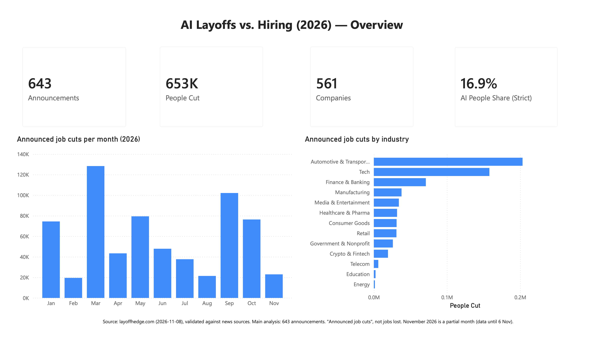
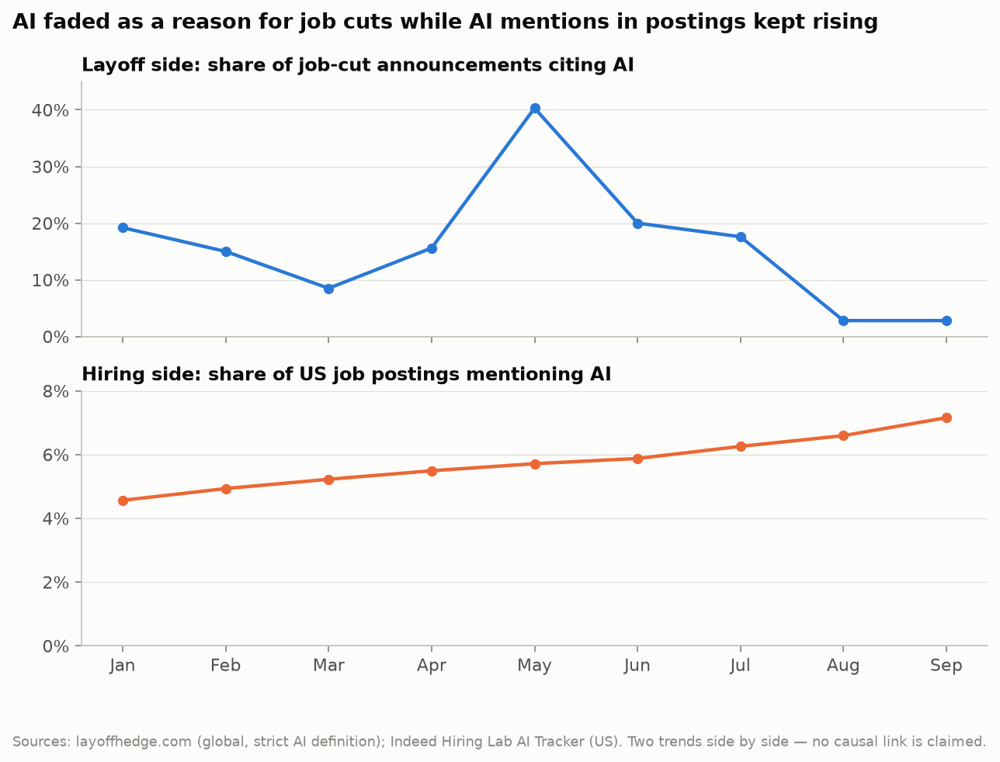
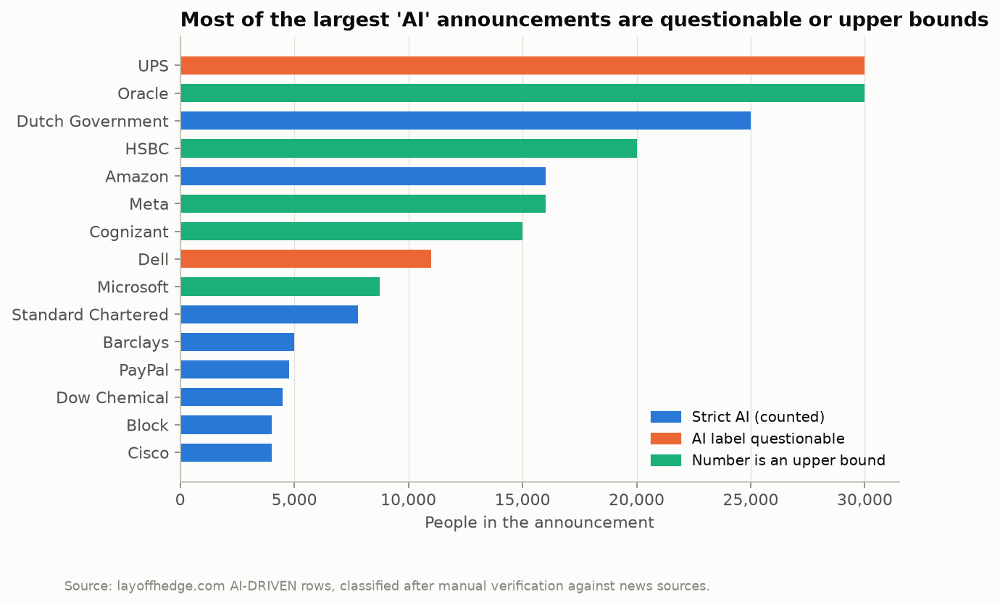

# Yapay zekâ işleri mi alıyor, yoksa sadece suçu mu üstleniyor?

*2026 işten çıkarma duyurularında yapay zekâ ile iş ilanlarında yapay zekâ*

[English](README.md) | **Türkçe** · 📖 [Yazıyı Medium'da okuyun](https://medium.com/@uguravsar10/yapay-zek%C3%A2-i%CC%87%C5%9Fleri-mi-al%C4%B1yor-yoksa-sadece-su%C3%A7u-mu-%C3%BCstleniyor-71f44f79ce58)

Neredeyse her hafta *"X şirketi yapay zekâ yüzünden binlerce kişiyi işten çıkarıyor"* gibi bir haber başlığı görüyoruz. Bu proje bu başlıkları veriyle sınıyor. Üç soruya yanıt arıyor: **Şirketler 2026'da işten çıkarma duyururken yapay zekâyı (AI) gerçekte ne sıklıkla gerekçe gösterdi? Bu oran yıl içinde nasıl değişti? Aynı dönemde iş ilanlarında AI'ın payına ne oldu?**



> Dashboard, grafikler ve sunum İngilizcedir. Bu sayfa projeyi Türkçe özetler.

---

## Temel bulgular

| | Bulgu |
|---|---|
| **6'da 1** | Duyurulan işten çıkarmalardaki kişilerin yaklaşık **6'da 1'i**, şirketin AI'ı gerekçe gösterdiği duyurularda yer alıyor (**%16,9**, %95 güven aralığı %8,8–27,5). Belirsiz "verimlilik / otomasyon" ifadelerini de sayan geniş tanımla bu oran en fazla %38,4. |
| **%40 → %3** | AI gerekçesi **Mayıs'ta zirve yaptı** (duyuruların %40'ı) ve **Ağustos'tan itibaren söndü** (ayda duyuruların yaklaşık %3–6'sı). Bağımsız bir kaynak olan Challenger, Gray & Christmas da ABD için aynı deseni gösteriyor (korelasyon 0,72). |
| **295'e 180** | AI gerekçeli duyurular **daha büyük**. Medyan (ortanca) değer AI duyurularında 295 kişi, diğerlerinde 180 kişi (fark 115, %95 güven aralığı 50–421; Mann-Whitney p < 0,001). |
| **2 kat** | İşe alım tarafında, **AI'dan bahseden ABD iş ilanlarının payı bir yılda ikiye katlandı** (Eylül 2025'te %3,6, Eylül 2026'da %7,2). İngiltere de aynı yolu izledi (%4,9'dan %9,8'e). |

> **Tek cümleyle:** 2026'da AI, işten çıkarma gerekçesi olarak söndü; iş ilanlarında ise giderek daha fazla yer aldı.
> İki eğilim **yan yana gösteriliyor. Bu bir neden-sonuç iddiası değildir.**



---

## Beş soru

| # | Soru | Yanıt |
|---|---|---|
| S1 | En çok işten çıkarma hangi sektörlerde duyuruldu? | **Otomotiv ve Ulaşım (%31)**, **Teknoloji (%24)** ve **Finans ve Bankacılık (%11)**, işten çıkarmalardaki kişilerin üçte ikisini oluşturuyor. En çok duyuru Teknoloji'de (139). |
| S2 | AI en çok hangi sektörlerde gerekçe gösterildi? | Yeterli duyurusu olan sektörlerde başı **Kripto ve Fintek** (kişilerin %68'i) ile **Finans ve Bankacılık** (%33) çekiyor. Çok küçük sektörler (10'dan az duyuru) ayrıca işaretlendi; orada tek bir duyuru oranı tamamen değiştirebiliyor. |
| S3 | AI payı yıl içinde nasıl değişti? | Ocak–Temmuz arası yüksek (duyuruların %8–20'si, Mayıs'ta %40), Ağustos'tan sonra düşük (%3–6). Challenger'ın ABD rakamları da aynı yönde hareket ediyor. |
| S4 | AI gerekçeli çıkarmalar daha mı büyük? | Evet. Medyan 295 kişiye 180 kişi; fark istatistiksel olarak anlamlı. |
| S5 | İş ilanlarında ne oldu? | AI'dan bahseden ilanların payı takip edilen her ülkede arttı; ABD ve İngiltere'de ikiye katlandı. (Kanada gösteriliyor ama karşılaştırmaya alınmıyor: Ontario'da yeni bir yasa, işverenlerin işe alımda AI kullandıklarını ilanda belirtmesini zorunlu kılıyor.) |

---

## Veri

| Veri | İçeriği | Rolü | Lisans |
|---|---|---|---|
| [layoffhedge.com](https://layoffhedge.com) 2026 işten çıkarma listesi (8 Kasım 2026 sürümü) | Dünya genelinde 653 duyuru: şirket, sektör, kişi sayısı, tarih, gerekçe, kaynak linki | Ana veri (işten çıkarma tarafı) | Kaynak gösterilerek serbest |
| [Indeed Hiring Lab, AI Tracker](https://www.hiringlab.org/) | AI'dan bahseden iş ilanlarının günlük payı, 9 ülke | Ana veri (işe alım tarafı) | CC BY 4.0 |
| [Challenger, Gray & Christmas](https://www.challengergray.com/) aylık raporları | ABD işten çıkarmaları ve AI gerekçeli çıkarmalar, Ocak–Ekim 2026 | Bağımsız çapraz kontrol | Kamuya açık rakamlar, kaynak gösterilerek |

Ayrıntılar ve atıflar için: [data/SOURCES.md](data/SOURCES.md). `data/raw/` içindeki ham dosyalar hiç değiştirilmedi.

---

## Veri nasıl kontrol edildi?

layoffhedge çok bilinen bir kaynak değil. Bu yüzden veri, analizden **önce** kontrol edildi:

- **653 satırın hepsinde otomatik kontrol:** boş değerler, tekrar eden satırlar, imkânsız değerler, yılı eksik tarihler ve kaynak linklerinin kalitesi.
- **146 satır haber kaynaklarıyla elle karşılaştırıldı:** 3.000 kişi ve üzeri her duyuru, AI etiketli her duyuru ve küçük duyurulardan rastgele bir örneklem. Bu satırlar verideki tüm kişilerin **%72'sini** kapsıyor.
- **Bulunan hatalar:** Yanlış yıla ait 4 duyuru (Intel, Nestlé, Nokia, CrowdStrike) analizden çıkarıldı. 2 sayı düzeltildi (Verizon 3.000'den 500'e, Commerzbank 6.900'den 3.000'e); orijinal değer ayrıca saklandı.
- **"Silme, işaretle" ilkesi:** Hiçbir satır silinmedi. Her satıra bir güvenilirlik seviyesi verildi (T1 elle doğrulanmış … T5 zayıf kaynak). Kişilerin **%81,6'sı en güvenilir üç seviyede**.
- **İki AI tanımı:** *Dar tanımda* şirket AI'ı açıkça söylüyor; tüm manşet rakamlar bu tanımla hesaplandı. *Geniş tanım* belirsiz "otomasyon / verimlilik" ifadelerini de sayıyor ve yalnızca üst sınır olarak raporlanıyor.
- **Sağlamlık ve istatistik:** Daha zayıf seviyeler çıkarıldığında da bulgular değişmiyor. Bootstrap güven aralıkları, Mann-Whitney testi, permütasyon testleri ve duyarlılık analizleri [docs/DATA_QUALITY.md](docs/DATA_QUALITY.md) dosyasında.



**Aylık eğilimde neden kişi sayısı değil de duyuru sayısı kullanıldı?** Çünkü tek bir dev duyuru bir ayı tek başına değiştirebiliyor. Örneğin Ekim'de Hollanda hükümetinin tek bir planı (25.000 kişi), AI'ın *kişi* payını %50,5'e çıkardı; oysa o ay *duyuruların* yalnızca %5,3'ü AI'ı gerekçe gösterdi. Bu yüzden aylık eğilim duyuru payıyla gösteriliyor.

---

## Sınırlılıklar

- Yalnızca habere yansıyan, **duyurulmuş** işten çıkarmalar var; küçük şirketler eksik temsil ediliyor.
- Gördüğümüz şey **şirketlerin söylediği gerekçe**, çıkarmanın gerçek nedeni değil.
- **Kapsamlar farklı:** İşten çıkarma verisi dünya geneli, iş ilanları 9 ülke (Türkiye yok), Challenger yalnızca ABD. Bu yüzden karşılaştırmalar kesin bir rakamı değil, **yönü** doğruluyor.
- "İlan AI'dan **bahsediyor**" ile "yeni bir AI işi açıldı" aynı şey değil.
- Hiçbir kaynakta **kıdem bilgisi** yok. Junior pozisyonlarla ilgili her yorum bir bulgu değil, yorumdur.
- Veri 10 aylık; bu yüzden korelasyonlar ve güven aralıkları geniş.
- Kasım 2026 eksik bir ay (veri 6 Kasım'a kadar).

---

## Proje nasıl yapıldı?

```text
data/raw  ──►  Python (pandas, numpy, scipy)  ──►  data/clean  ──►  PostgreSQL (yıldız şema, 41 kontrol)
               temizlik · doğrulama · testler                         │
                                                                      ├──►  Jupyter notebook (9 grafik)
                                                                      ├──►  Power BI dashboard (4 sayfa)
                                                                      └──►  PowerPoint sunumu (16 slayt)
```

Her rakam önce Python'da hesaplandı, sonra **SQL'de bağımsız olarak yeniden hesaplandı**. `sql/04_checks.sql` 41 rakamı karşılaştırıyor ve hepsi tutuyor. Dashboard ve sunum da aynı dosyaları okuyor; böylece bütün çıktılarda aynı rakamlar görünüyor.

| Çıktı | Nerede |
|---|---|
| Analiz notebook'u (soru, kod, grafik, yorum) | [notebooks/analysis.ipynb](notebooks/analysis.ipynb) |
| Power BI dashboard (Overview · AI Narrative · Hiring Side · Data Reliability) | [powerbi/dashboard.pbix](powerbi/dashboard.pbix) · [PDF](powerbi/dashboard.pdf) · [ekran görüntüleri](powerbi/screenshots/) |
| Sunum (15 dakika, konuya yabancı dinleyici için, konuşmacı notlarıyla) | [presentation/AI_Layoffs_vs_Hiring_2026.pptx](presentation/AI_Layoffs_vs_Hiring_2026.pptx) |
| Her adım ve karar, sıfırdan (İngilizce) | [docs/PROCESS.md](docs/PROCESS.md) |
| Veri kalitesi ve doğrulama (İngilizce) | [docs/DATA_QUALITY.md](docs/DATA_QUALITY.md) |

### Çalıştırma

```bash
pip install -r requirements.txt

# 1) Python: temizlik, doğrulama, testler (data/raw okunur, data/clean yazılır)
python3 python/clean_layoffs.py
python3 python/robustness_check.py
python3 python/clean_ai_posting.py
python3 python/build_challenger.py
python3 python/statistical_tests.py

# 2) PostgreSQL: yükleme, analiz, çapraz kontrol, Power BI için dışa aktarma (proje kök klasöründen)
createdb -U postgres ai_is_piyasasi
for f in sql/0*.sql; do psql -U postgres -d ai_is_piyasasi -v ON_ERROR_STOP=1 -f "$f"; done

# 3) Sunum (isteğe bağlı): sunumu data/clean dosyalarından yeniden üret
python3 presentation/build_deck.py
```

Power BI için `powerbi/dashboard.pbix` dosyasını Power BI Desktop'ta açın; veri zaten içinde. CSV dosyalarından yeniden kurmak için: [powerbi/README.md](powerbi/README.md).

---

## Lisans ve yazar

Kod ve dokümantasyon [MIT](LICENSE) lisanslı. Veri kendi orijinal koşullarını korur (bkz. [data/SOURCES.md](data/SOURCES.md)).
Veri kaynakları: layoffhedge.com · Indeed Hiring Lab (CC BY 4.0) · Challenger, Gray & Christmas.

**Uğur Avşar**, Softito Veri Analitiği-2 programı bitirme projesi, Kasım 2026.
