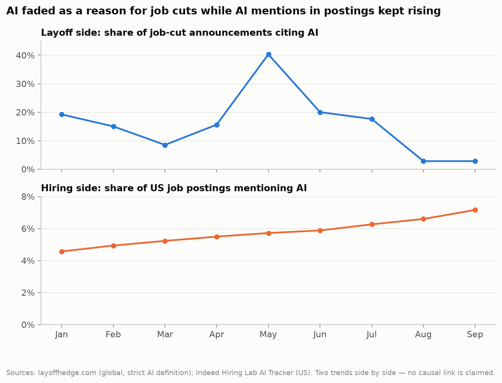
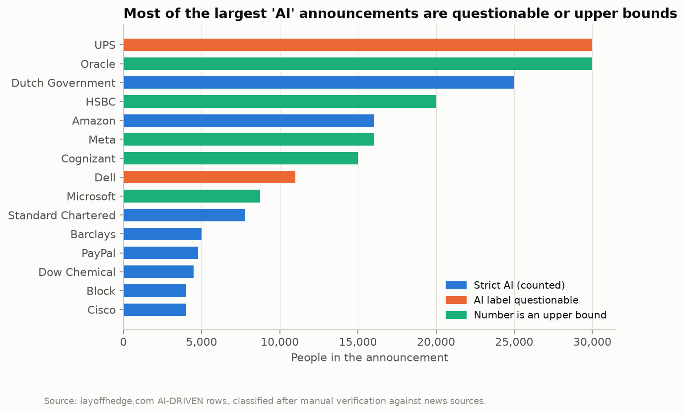
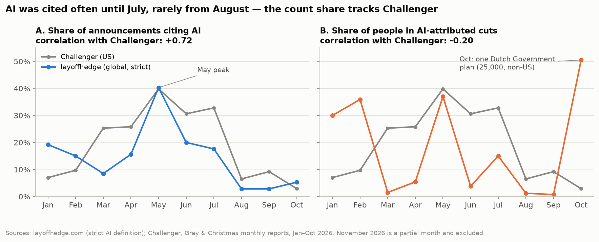
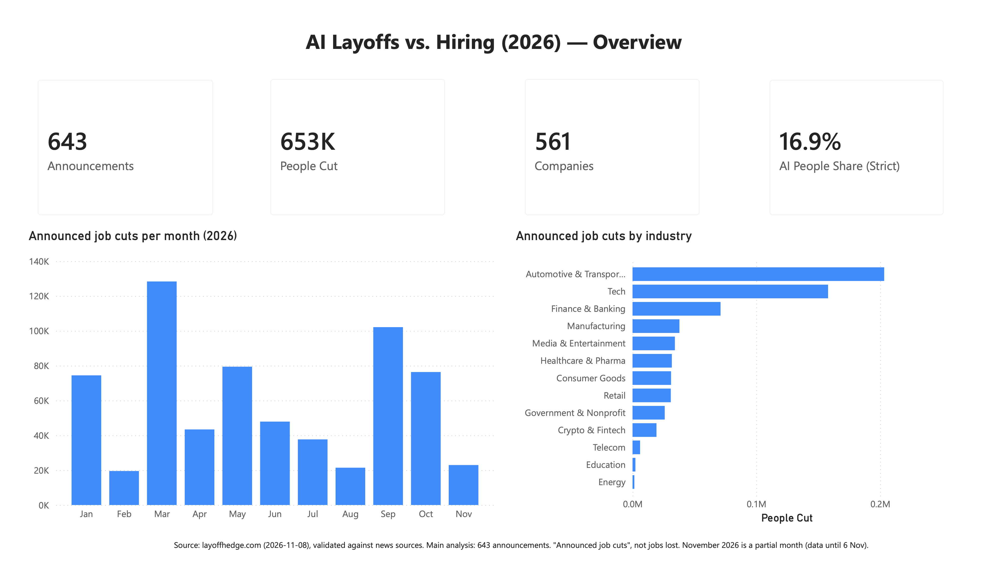

# Is AI Taking Jobs — or Just Taking the Blame?

*I checked 643 layoff announcements from 2026 against the news. Here is what companies actually said, and what happened to job postings at the same time.*

---

Almost every week this year, I read a headline like *"Company X cuts thousands of jobs as it bets on AI."* As someone about to enter the job market as a data analyst, I wanted to know: **is that the real story, or just the loudest one?**

So for my capstone project I asked three simple questions:

1. How often did companies actually name AI when they announced job cuts in 2026?
2. Did that change over the year?
3. What happened to AI in job postings during the same months?

Here is the short answer first.

- **About 1 in 6** people in announced job cuts were in cuts that companies attributed to AI (16.9%).
- AI as a stated reason **peaked in May** (40% of announcements) and **faded from August** (about 3–6%).
- AI-attributed announcements were **bigger**: 295 people at the median, compared with 180 for the rest.
- Meanwhile, the share of **US job postings mentioning AI doubled** in a year, from 3.6% to 7.2%.

*Two trends side by side, January–September 2026. This is not a cause-and-effect claim. Sources: layoffhedge.com, Indeed Hiring Lab.*

In other words, **AI faded as a reason for job cuts while it showed up more and more in job postings.** The rest of this post explains how I got there, and why some of the most-shared "AI layoff" numbers deserve a second look.

---

## Three sources, one question

I used three public data sources:

- **layoffhedge.com**, a list of 653 layoff announcements worldwide in 2026, with the company, industry, number of people, date, stated reason and a source link.
- **Indeed Hiring Lab's AI Tracker**, the share of job postings that mention AI, in nine countries (CC BY 4.0).
- **Challenger, Gray & Christmas**, a long-running US outplacement firm that publishes monthly job-cut reports, including how many cuts employers attribute to AI. I used it as an independent check.

One wording rule I kept throughout: these are **announced job cuts**, not "jobs lost". An announcement is a plan; it is what a company *says*.

---

## Before trusting the data, I checked it

layoffhedge is not a famous source, so I did not take it at face value. Before any analysis, I spent the first part of the project checking it.

**Automatic checks on all 653 rows**: blanks, duplicates, impossible values, dates without a year, and the quality of each source link.

**Then 146 rows by hand.** I did not check rows at random. I checked them by *materiality*: every announcement with 3,000 or more people, every announcement labelled as AI-driven, and a random sample of the small ones. Together, those 146 rows cover **72% of all the people** in the data. For each one, I opened news coverage and compared the company, the number and the date.

That found real problems:

- **Four announcements were from the wrong year.** Intel, Nestlé, Nokia and CrowdStrike appeared as 2026 cuts, but the news coverage was about earlier years. I excluded them from the analysis.
- **Two numbers were wrong.** Verizon was listed at 3,000 people instead of 500, and Commerzbank at 6,900 instead of 3,000. I corrected both and kept the original values.

I followed one rule: **flag, don't delete.** No row was removed from the file. Every row instead got a reliability level, from *T1 (verified by hand)* to *T5 (weak source)*. In the end, **81.6% of all people sit in the three most reliable levels**, so the conclusions do not depend on shaky rows.

---

## Not every "AI layoff" is really about AI

The most interesting finding came from the checking itself. The source labels some cuts as "AI-driven", but when I read the news behind the biggest ones, the label did not always hold up:

- **UPS, 30,000 people.** The main reason reported was less delivery volume from Amazon, not AI.
- **Oracle, "up to 30,000".** That is a maximum, not a final number.

*The 15 largest announcements labelled AI-driven, after checking each one against news sources.*

So I used **two definitions**:

- **Strict:** the company clearly cites AI, the label is not questionable, and the number is not an "up to" figure. **16.9%** of people in announced cuts. I use this for every headline number.
- **Broad:** every AI label, as published. **38.4%.** A handful of giant, uncertain announcements inflate this one, so I report it only as an upper bound.

The gap between those two numbers, 16.9% and 38.4%, is the gap between what the headlines suggest and what the evidence supports.

---

## AI peaked in May, then faded

Next I looked at the year month by month, and I made one deliberate choice: **I counted announcements, not people.**

The reason is October. That month, a single plan by the Dutch government, covering 25,000 people, was attributed to AI. Counting people, AI suddenly explained **50.5%** of the month. Counting announcements, only **5.3%** cited AI. One giant plan should not be able to rewrite a whole month, so for the trend I used the share of announcements.

*Left: share of announcements citing AI, compared with Challenger's US figures. Right: the same by people, which jumps with single giant announcements.*

The pattern is clear. Between January and July, 8–20% of announcements cited AI, with a peak of **40% in May**. From August, it dropped to **about 3–6%**.

This is where the independent check mattered. Challenger's US data follows the same shape, with a correlation of **0.72**. The two sources do not cover the same places (worldwide vs. US only), so this does not prove an exact number. But it confirms the **direction**: AI as a stated reason rose in spring and faded after the summer.

---

## AI-attributed cuts are larger

When companies did cite AI, the announcements were bigger. The median AI-attributed announcement covered **295 people**, compared with **180** for the others.

To make sure this was not luck, I tested it. A bootstrap confidence interval for the difference (115 people) runs from 50 to 421, so it stays above zero, and a Mann-Whitney test gives p < 0.001. In plain terms, the difference is very unlikely to be a coincidence.

---

## Meanwhile, on the hiring side

Now the other half of the picture. While AI faded as a reason for cuts, the share of **US job postings mentioning AI** rose almost every month, from **3.6% in September 2025 to 7.2% in September 2026**. The UK followed the same path (4.9% to 9.8%), and the share rose in all nine countries I looked at.

A careful note: a posting that *mentions* AI is not the same as a new AI job. It can be a role that uses AI tools, a company that sells AI products, or a disclosure that AI is used in hiring. So the correct reading is narrow: **AI is showing up in more and more job descriptions.**

---

## What this suggests, and what it doesn't

My interpretation: in 2026, **AI looked less like a layoff threat and more like a requirement in job postings.** For anyone job hunting, including me, that suggests two things:

- **Read layoff headlines critically.** "The company says AI" is not the same as "AI caused it".
- **Build AI literacy.** More and more postings mention it.

I want to be just as clear about what this analysis **cannot** tell us:

- It only covers **announced** cuts that reached the news. Small companies are under-represented.
- It shows **stated reasons**, not true causes.
- The sources have **different scopes**: layoffs worldwide, postings in nine countries (not Turkey), Challenger in the US only.
- **No source includes seniority**, so I cannot say anything specific about junior roles.
- Ten months of data is short, so the confidence intervals are wide.
- I show the two trends **side by side**. I do not claim that one causes the other.

---

## How I built it

The project is pure data analysis, with no machine learning:

- **Python** (pandas, numpy, scipy) for cleaning, verification and statistical tests.
- **PostgreSQL** with a star schema, where every key number is **recalculated independently in SQL**. All 41 cross-checks match the Python results.
- A **Jupyter notebook** with nine charts, a **Power BI dashboard** with four pages, and a 15-minute presentation, all reading the same files so that every output shows the same numbers.

*The Power BI dashboard: Overview · AI Narrative · Hiring Side · Data Reliability.*

If I had to sum up the project in one lesson: **the most valuable hours were the ones spent checking the data before analysing it.** Checking found four wrong-year rows and two wrong numbers, and a handful of questionable labels and "up to" figures were enough to cut the AI share of people in announced cuts by more than half, from 38.4% to 16.9%.

The code, the data, every verification decision and the dashboard are on GitHub:
**[github.com/Uguravsar75/ai-layoffs-vs-hiring-2026](https://github.com/Uguravsar75/ai-layoffs-vs-hiring-2026)**

I would love to hear what you think, especially if you work with layoff or labour-market data. What would you check next?

---

*Data: layoffhedge.com (2026 layoff list, version of 8 November 2026) · Indeed Hiring Lab AI Tracker (CC BY 4.0) · Challenger, Gray & Christmas monthly job-cut reports. This post is part of my capstone project for the Softito Data Analytics program.*
